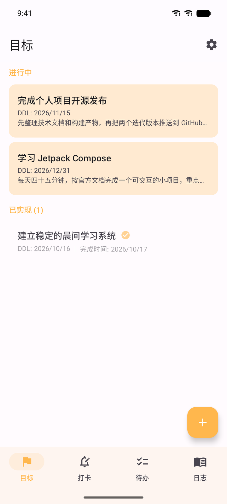
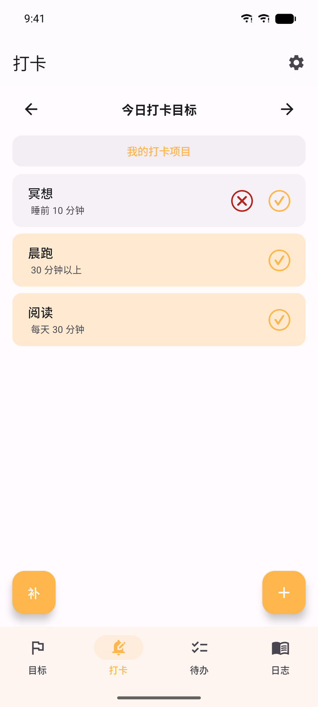
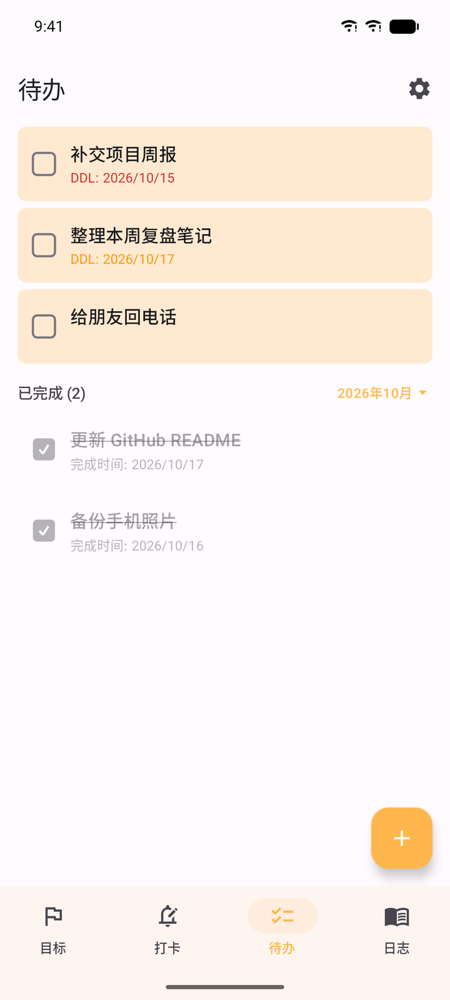
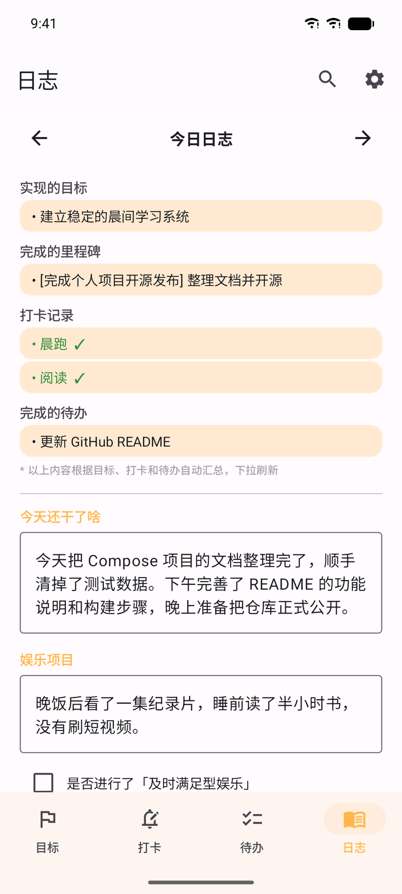
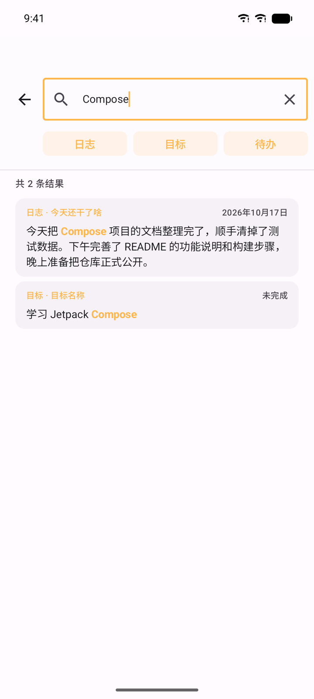
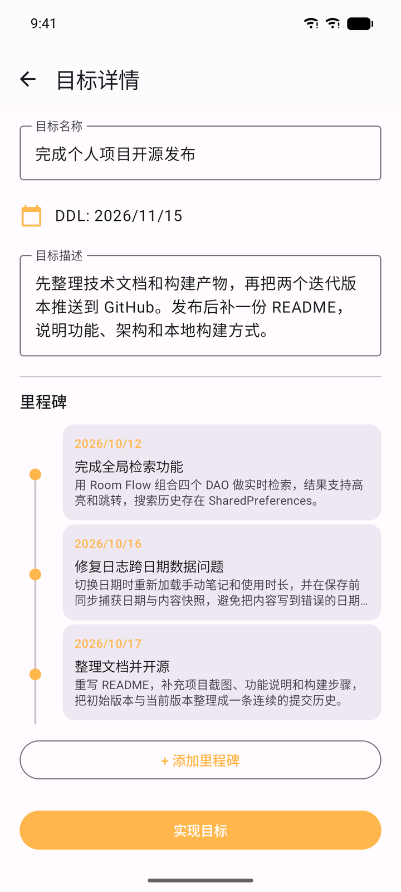
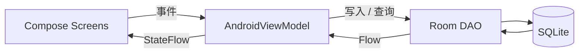

# 整点薯条

<p align="center">
  
</p>

<p align="center">
  <b>把目标、习惯、待办和每一天，留在自己的设备里。</b>
</p>

<p align="center">
  
  
  
  
  
</p>

**整点薯条**是一款完全离线的 Android 个人管理应用。它把长期目标、每日打卡、待办事项和日记放进同一个轻量界面，让工具退到幕后，把注意力留给真正想做的事。

应用不申请网络权限，不需要注册账号，也没有云同步。所有数据只保存在本机，随时可以导出带走。

> An offline-only Android app for goals, habits, todos and daily journaling.  
> No account, no cloud, no network permission.

## 界面预览

<p align="center">
  
  
  
</p>
<p align="center"><sub>目标 · 打卡 · 待办</sub></p>

<p align="center">
  
  
  
</p>
<p align="center"><sub>日志 · 全局检索 · 目标详情</sub></p>
<p align="center"><sub>截图中的数据均为演示数据</sub></p>

## 功能

### 目标

- 为长期目标设置截止日期（DDL）与描述，列表按截止时间排序。
- 用里程碑时间轴记录每一次推进：完成了什么、花了多久、遇到什么难点、下一步做什么。
- 目标实现后自动归档并锁定编辑，避免误改；需要时仍可撤销。
- 双击已设置的 DDL 可以取消，减少为改日期而进入编辑页的次数。

### 打卡

- 支持每天、每周指定日两种周期，适合习惯养成和固定安排。
- 仅当天可以打卡；未完成的项目会在次日自动记为放弃，并同步到日志。
- 支持补卡、暂停 / 恢复项目，以及查看"我的打卡项目"。
- 历史和未来日期保持锁定，避免篡改记录。

### 待办

- 快速记录待办，可选设置 DDL；当天到期显示橙色，已过期显示红色。
- 未完成待办全部展示，按"有 DDL 的先后，无 DDL 的按创建顺序"排列。
- 已完成待办按月份筛选并自动折叠，长期使用也不会淹没当前任务。

### 日志

- 每天自动汇总：实现的目标、完成的里程碑、打卡记录、完成的待办。
- 手动补充"今天还干了啥"、娱乐项目、是否进行及时满足型娱乐。
- 可记录手机使用时长与常用应用，帮助观察时间去向。
- 通过日期栏回看任意一天；历史日志默认只读，确认后可临时解锁编辑。

### 全局检索

- 一个入口搜索日志、目标、里程碑和已完成待办。
- 分类 chip 支持全选、单选和取消；关键词高亮，长文本自动截取上下文。
- 结果可直接跳转到对应日期、目标详情或待办列表。
- 搜索历史保存在本机，可逐条删除或全部清除。

### 个性化与数据

- 浅色 / 深色模式，6 种低饱和度主题色，也可以输入自定义色号。
- 每日提醒：自定义时间与文案，重启手机后自动恢复。
- 导出 SQLite 数据库用于换机，或导出 TSV ZIP 用于表格分析；支持导入 SQLite 恢复数据。

## 设计原则

- **离线优先**：Manifest 中没有 `INTERNET` 权限，没有账号体系、云同步、统计 SDK 或广告。
- **数据属于用户**：数据保存在本机 Room / SQLite 中，随时可以完整导出；应用卸载前请自行备份。
- **保持简单**：单 Activity + 状态驱动导航，手动数据库单例，不引入 Hilt、Navigation Compose 等额外框架。
- **数据只应因用户输入而改变**：日志按日期严格隔离，切换到历史日期不会污染今天，保存前会捕获日期与内容快照。

## 技术栈

| 层级 | 选型 |
|------|------|
| 语言 | Kotlin 1.9.24 |
| UI | Jetpack Compose + Material 3（BOM 2024.05.00） |
| 架构 | MVVM，单 Activity，状态驱动导航 |
| 数据库 | Room 2.6.1（SQLite，schema v10） |
| 异步 | Kotlin Coroutines + Flow / StateFlow |
| 构建 | Gradle 8.13、AGP 8.13.2、KSP 1.9.24-1.0.20 |
| 系统 | minSdk 26（Android 8.0）/ targetSdk 34（Android 14） |



数据从 Room 通过 `Flow` 转换为 `StateFlow` 驱动界面；写操作统一放在 `viewModelScope` 中，数据库由 `TodoApplication` 手动持有单例。更完整的设计说明、数据库结构与开发注意事项见 [项目技术文档](docs/项目技术文档.md)。

## 项目结构

```text
app/src/main/java/com/example/todoapp/
├── MainActivity.kt              # 单 Activity，状态驱动页面切换
├── TodoApplication.kt           # 数据库单例、通知渠道
├── data/
│   ├── AppDatabase.kt           # Room 数据库（v10）
│   ├── AppConstants.kt
│   ├── dao/                     # 五组 DAO
│   └── entity/                  # 目标、里程碑、待办、日志、打卡
└── ui/
    ├── goal/                    # 目标列表、目标详情、里程碑
    ├── checkin/                 # 打卡、补卡、我的打卡项目
    ├── todo/                    # 待办列表与编辑
    ├── journal/                 # 每日日志与自动汇总
    ├── search/                  # 全局检索
    ├── settings/                # 主题、提醒、数据导入导出
    ├── components/              # 共用组件（如只读可滚动文本）
    ├── navigation/              # Screen 状态导航
    └── theme/                   # Material 3 主题与配色
```

## 快速开始

环境要求：**JDK 17**、**Android SDK 34**。Gradle Wrapper 已内置，无需单独安装 Gradle。

```bash
git clone https://github.com/ohSteve/Fires.git
cd Fires

# 指向本机 Android SDK；用 Android Studio 打开项目时会自动生成
echo "sdk.dir=/path/to/Android/Sdk" > local.properties

# 构建 Debug APK
./gradlew assembleDebug        # Windows: gradlew.bat assembleDebug

# 安装到已连接的设备
adb install app/build/outputs/apk/debug/app-debug.apk
```

APK 输出在 `app/build/outputs/apk/debug/app-debug.apk`。如果只想直接安装，可以下载 [Releases](https://github.com/ohSteve/Fires/releases) 中已构建好的安装包。

## 权限说明

| 权限 | 用途 |
|------|------|
| `PACKAGE_USAGE_STATS` | 可选。用户在系统设置中授权后，日志页可读取本机使用时长；不授权不影响其他功能。 |
| `POST_NOTIFICATIONS` | 可选的每日提醒通知。 |
| `RECEIVE_BOOT_COMPLETED` | 重启后恢复提醒。 |

没有网络权限，没有后台上传，也没有第三方埋点。

## 已知限制

- 仅提供中文界面，暂未适配多语言、TalkBack 和平板布局。
- 单机应用，没有云同步和自动备份；卸载或清除数据前请先导出 SQLite。
- 手机使用时长依赖系统「使用情况访问」权限，未授权时该模块不可用。
- 暂未加入单元测试与 CI；数据量很大时列表尚未分页。
- 当前 Release 构建未开启混淆，APK 体积约 16 MB。

## 参与贡献

欢迎提交 Issue 和 Pull Request。参与前请确认：

1. 保持完全离线：不要新增 `INTERNET` 权限、云同步或统计 SDK。
2. 遵循现有架构与代码风格；涉及数据库字段变更时，请同时编写 Migration 并提升 schema 版本。
3. 提交 PR 前请先在本地执行 `./gradlew assembleDebug`，确认项目可以构建。

较大的功能改动建议先开 Issue 讨论，避免方向不一致。

## 版本记录

各次迭代的详细变化见 [CHANGELOG.md](CHANGELOG.md)，可安装的构建见 [Releases](https://github.com/ohSteve/Fires/releases)。

## 许可证

本项目基于 [MIT License](LICENSE) 开源，Copyright © 2026 ohSteve。

---

如果这个项目对你有帮助，欢迎点一个 ⭐。
